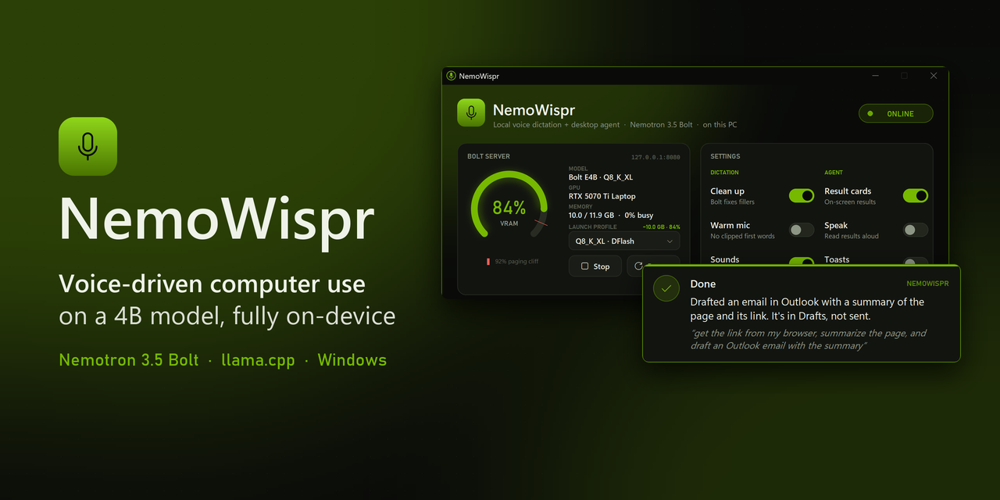

# NemoWispr



Local, offline voice control for Windows, built on NVIDIA Nemotron 3.5 Bolt E4B ("Bolt") running in llama.cpp.

- **Dictation.** Hold **Ctrl+Win**, speak, and release. Bolt transcribes the audio and tidies it up: it removes fillers, applies spoken corrections and fixes punctuation and lists. The text is then pasted at the cursor. It works like Wispr Flow, but nothing leaves the machine.
- **Voice commands.** Hold **Ctrl+Win+Shift**, say what to do, and release. A desktop agent on the same model operates apps through Windows UI Automation. A card in the corner shows what it heard, what it's doing, and the result.

Every risky step is guarded in code, not by prompting. That covers sending, deleting, replacing text, discarding unsaved work, and unusual keys. Each needs a Yes/No confirmation. Terminals and shells are off limits. Typed text is read back to check it arrived.

## Requirements

- Windows 11 and an NVIDIA GPU with 12 GB (developed on an RTX 5070 Ti Laptop GPU).
- A llama.cpp CUDA build (developed on b12419 / CUDA 13.5), by default in `%USERPROFILE%\llama.cpp`.
- [unsloth/NVIDIA-Nemotron-3.5-Bolt-E4B-GGUF](https://huggingface.co/unsloth/NVIDIA-Nemotron-3.5-Bolt-E4B-GGUF): `UD-Q8_K_XL`, `mmproj-F16` (needed for audio input) and the DFlash drafter.
- [uv](https://docs.astral.sh/uv/). The Python scripts declare their dependencies inline (PEP 723), so there's no install step.
- A microphone.

## Run

```powershell
.\scripts\run-bolt.ps1      # Bolt on http://127.0.0.1:8080 (ctx 128K, audio+vision, DFlash); ~84% of 12 GB VRAM
.\start-nemowispr.cmd         # tray app; the icon may be hidden under the taskbar's ^ arrow
```

`run-bolt.ps1` takes `-LlamaDir` and `-ModelDir` (or `$env:LLAMA_CPP_DIR` / `$env:BOLT_MODEL_DIR`). It also has `-NoDFlash`, which brings VRAM down to ~71% and makes generation slower. Keep VRAM below ~92%: past that, Windows pages graphics memory and speed collapses. The server binds to 127.0.0.1 only.

## Using it

| Do this | Result |
|---|---|
| Hold Ctrl+Win, speak, release | Cleaned-up text is pasted where the cursor is |
| Hold Ctrl+Win+Shift (Shift any time during the hold), speak, release | The agent carries out the command; the card shows progress, then the result |
| Name a document in a command ("open the Q3 report…") | The agent opens it from Documents, Desktop or Downloads (documents only, never programs) |
| "Get the link from my browser, summarize the page, and draft an email with it" | The agent reads the address bar, summarizes the page, and opens a filled-in draft in your mail app. It never sends; you review it |
| "Put a meeting with Priya on my calendar tomorrow at 3", "make a note called groceries…" | A pre-filled event, note or Teams message opens for you to review (whichever apps you have) |
| "What's 15% of 426,600?", "put this window on the left half" | Exact maths in code, not by the model; window snapping and maximizing ("close" always asks) |
| Press any key while the agent works | It stops |
| Hold Ctrl+Win+Shift within 2 minutes of a question | Your answer continues the same task |
| Say "start over" / "new conversation" / "clear the context" | The agent forgets the conversation (it also forgets after 15 idle minutes) |
| Say "stop" / "cancel" / "never mind" in answer to a question | That task ends |

Card colours:
- green: done and checked on screen (a spinner and a sweeping bar while it works);
- amber: done but not confirmed;
- blue: a question for you;
- red: didn't work;
- grey: stopped.

### Control panel

Left-click the tray icon (or choose **Open control panel**) for the panel:
- **Bolt server:** online/loading/offline, a live VRAM gauge with the ~92% paging cliff marked, and the running model, quant and decoding.
- **Launch profile:** a dropdown of every Bolt GGUF on disk × DFlash on/off, each with its estimated VRAM. For example, Q8_K_XL with DFlash is ~10.0 GB (84%), the fastest; without DFlash it's ~8.5 GB (71%), with faster prefill. Download another quant from the unsloth repo and it appears here. The choice is saved in `bolt-profile.json`. Only Bolt files are offered, because dictation needs Bolt's audio encoder and the DFlash drafter is trained against it.
- **Start / Stop / Restart.** Start runs `scripts\run-bolt.ps1 -Model … [-NoDFlash]` hidden, logging to `bolt.log`, and asks for a second click if the profile wouldn't fit in the free VRAM. **Switch** (Restart) lights up when the chosen profile differs from the running one. Stop and Restart need a second click, are refused while the agent runs, and only kill the `llama-server.exe` that owns the port. Restart re-checks the VRAM fit after the old server has let go.
- **Today:** words dictated, median dictation latency, agent runs and how many were verified on screen.
- **Settings:** clean-up, warm mic (which prevents clipped first words; Windows shows its mic-in-use indicator while it's on), sounds, on-screen results, spoken results and Windows notifications.
- **Recent:** the last five dictations and commands. The eye icon masks the text, for screen recordings.
- **Actions:** Retry last failed, Copy last raw transcript, Forget the agent conversation, and open the Logs folder.

The agent can't see or click the panel: every window of this process is off limits to it. The right-click tray menu still has the same toggles and Quit.

```powershell
uv run --script nemowispr.py --panel        # the panel on its own, without the hotkey or mic
```

## Tests

```powershell
.\tests\run-tests.ps1                 # smoke + dictation selftest + agent sandbox suite (10 checks), with pass/fail counts
.\tests\run-tests.ps1 -Full           # adds the basic "send, declined" case: run it when the confirmation dialog changes
uv run --script nemowispr.py --selftest      # dictation only: 10 synthetic clips in tests\clips (baseline 9/10)
.\tests\agent\agent-e2e.ps1 -Command "..." -Confirm yes -Cards -Name x   # one agent run against the sandbox
```

The agent tests drive `AgentSandbox.exe`, a harmless WinForms window whose Send button only writes a log file. The scripts build it from `AgentSandbox.cs` on first use, using Windows PowerShell 5.1. Sandbox modes:
- `-Mangle` garbles typed text, to test the read-back check;
- `-Busy` puts 100 decoy buttons ahead of the form, like Outlook;
- `-Prefill` starts the message box with text in it;
- `agent-e2e-two.ps1` opens two copies of the window and runs a multi-turn conversation.

Don't point agent tests at real apps.

## Data and privacy

Everything runs locally. The app writes to `%USERPROFILE%\.local\dictate`, which you can change with `BOLT_DICTATE_HOME`:
- `dictate.log` and `history.jsonl`, which record every dictation and command, including any text the agent replaced, so a mistaken Yes can be recovered;
- `last-failed.wav`;
- generated tones.

None of this is in the repo.

## Layout

```
nemowispr.py          tray app: hotkey, mic, transcription + cleanup, paste, on-screen card, CLI test modes
nemowispr_agent.py    the desktop agent: tools, prompts, session memory, all safety gates
nemowispr_ui.py       the look (NVIDIA green), result-card artwork, control panel, Bolt start/stop
start-nemowispr.cmd   launches the tray app (uvw, no console)
scripts/run-bolt.ps1    llama-server launcher for Bolt, with measured VRAM numbers
tests/                  run-tests.ps1, dictation clips, agent sandbox + e2e scripts
docs/NOTES.md           design notes and what each fix was for
ROADMAP.md              what's next
```

## Status

This is a working prototype. Dictation is solid. The agent handles simple single-app tasks; it struggles with complex apps and with nuance, because it's a 4B model. The confirmations and the "Heard:" line on the card are how you catch its mistakes. See [ROADMAP.md](ROADMAP.md).

## License

[Apache-2.0](LICENSE). The Nemotron 3.5 Bolt weights and llama.cpp are separate projects, under their own licenses.
